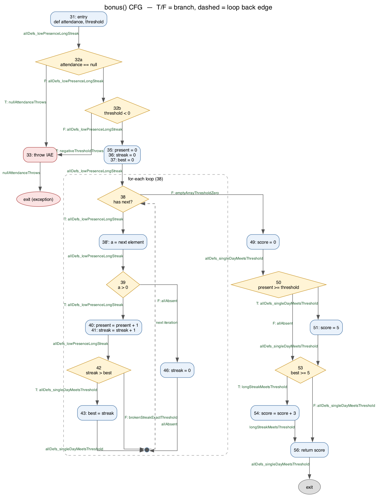

# Лаборатори №10: Өгөгдлийн урсгалын тест — Definition-Use хосууд

- **Оюутны нэр:** Б. Намуундарь
- **Оюутны код:** B232270037

## Орчин

JUnit 5.10.2, JaCoCo 0.8.12 (`pom.xml`-д заасан).

`java -version`:

```
openjdk version "17.0.17" 2025-10-21
OpenJDK Runtime Environment Homebrew (build 17.0.17+0)
OpenJDK 64-Bit Server VM Homebrew (build 17.0.17+0, mixed mode, sharing)
```

`mvn -version`:

```
Apache Maven 3.9.12 (848fbb4bf2d427b72bdb2471c22fced7ebd9a7a1)
Maven home: /opt/homebrew/Cellar/maven/3.9.12/libexec
Java version: 17.0.17, vendor: Homebrew, runtime: /opt/homebrew/Cellar/openjdk@17/17.0.17/libexec/openjdk.jdk/Contents/Home
Default locale: en_MN, platform encoding: UTF-8
OS name: "mac os x", version: "15.6", arch: "aarch64", family: "mac"
```

## Хэсэг A: gcd — DU хосууд

Мөрийн дугаар нь `DataFlowTargets.java` файлынх (слайд → файл: 1→13, 3→15, 4→16, 5→17, 6→18, 8→20).

**Def/Use:**

- **x**: def 13, 17 · c-use 16, 20
- **y**: def 13, 18 · p-use 15 (T: 15→16, F: 15→20) · c-use 16, 17
- **tmp**: def 16 · c-use 18

**Тестүүд** (`GcdTest.java`):

| ID | Оролт | Давталт | Үр дүн |
|----|-------|---------|--------|
| T1 | gcd(7, 0) | 0 | 7 |
| T2 | gcd(8, 4) | 1 | 4 |
| T3 | gcd(12, 8) | 2 | 4 |

**Бүх DU хос (13):**

| # | Хувьсагч | Def мөр | Use мөр | c-use/p-use | Def-clear зам | Тестийн ID | Хамрагдсан эсэх |
|---|----------|---------|---------|-------------|---------------|------------|-----------------|
| 1 | x | 13 | 16 | c-use | 13-14-15-16 | T2, T3 | Тийм |
| 2 | x | 13 | 20 | c-use | 13-14-15-20 | T1 | Тийм |
| 3 | x | 17 | 16 | c-use | 17-18-15-16 | T3 | Тийм |
| 4 | x | 17 | 20 | c-use | 17-18-15-20 | T2, T3 | Тийм |
| 5 | y | 13 | (15,16) | p-use (T) | 13-14-15-16 | T2, T3 | Тийм |
| 6 | y | 13 | (15,20) | p-use (F) | 13-14-15-20 | T1 | Тийм |
| 7 | y | 13 | 16 | c-use | 13-14-15-16 | T2, T3 | Тийм |
| 8 | y | 13 | 17 | c-use | 13-14-15-16-17 | T2, T3 | Тийм |
| 9 | y | 18 | (15,16) | p-use (T) | 18-15-16 | T3 | Тийм |
| 10 | y | 18 | (15,20) | p-use (F) | 18-15-20 | T2, T3 | Тийм |
| 11 | y | 18 | 16 | c-use | 18-15-16 | T3 | Тийм |
| 12 | y | 18 | 17 | c-use | 18-15-16-17 | T3 | Тийм |
| 13 | tmp | 16 | 18 | c-use | 16-17-18 | T2, T3 | Тийм |

all-DU-pairs хамралт: **13/13 (100%)**. Лекцид дутуу үлдсэн хосууд нь ихэвчлэн давталтын арын ирмэгээр (18→15) дамждаг хосууд: #3, #9, #11, #12.

**Асуултын хариу:**

- **gcd(7,0)** давталтад огт орохгүй тул зөвхөн **(x, 13, 20)** ба **(y, 13, (15,20))** хосыг хамарна. Эдгээр хоёр хосыг зөвхөн y=0 оролт л хамардаг (y≠0 бол 15→20 замд x нь 17-д дахин тодорхойлогдож, 13-ын def "kill" болно). Тиймээс энэ тестгүйгээр all-DU-pairs хамралт бүрэн болохгүй.
- **gcd(12,8)** **2 давталт** хийнэ: (12,8) → (8,4) → (4,0).
  - Дор хаяж **1 давталт** шаарддаг: #1, #4, #5, #7, #8, #10, #13 (давталтын биеийг гүйцэтгэх ёстой).
  - Дор хаяж **2 давталт** шаарддаг: #3 (x,17,16), #9 (y,18,(15,16)), #11 (y,18,16), #12 (y,18,17) — 17/18-д тодорхойлсон утгыг дараагийн давталт ашиглана.

## Хэсэг B: bonus — бүрэн анализ

### B1 — CFG
**Graphviz** ашиглан зурсан: `cfg-bonus.png`. Ирмэг бүрийн хажууд түүнийг дайрдаг `BonusTest`-ийн метод нэр бичигдсэн; тасархай ирмэг = давталтын буцах ирмэг.


Мөр 32-ын `||` нь short-circuit тул 2 зангилаа: **32a** (`attendance == null`), **32b** (`threshold < 0`). For-each: **38** = дараагийн элемент байгаа эсэх (attendance-ийн p-use), **38'** = `a`-д оноох (a-ийн def).

### B2 — Def/Use
```
31:  def attendance, threshold
32a: p-use attendance            32b: p-use threshold
35:  def present                 36: def streak          37: def best
38:  p-use attendance            38': def a
39:  p-use a
40:  c-use present, def present
41:  c-use streak,  def streak
42:  p-use streak, best
43:  c-use streak,  def best
46:  def streak
49:  def score
50:  p-use present, threshold
51:  def score
53:  p-use best
54:  c-use score,   def score
56:  c-use score
```

### B3 — DU хүснэгт
| # | Хувьсагч | Def | Use | Төрөл | Def-clear зам | Тестийн ID |
|---|---|---|---|---|---|---|
| 1 | attendance | 31 | (32a,33) | p-use T | 31-32a-33 | P1 |
| 2 | attendance | 31 | (32a,32b) | p-use F | 31-32a-32b | D1 |
| 3 | attendance | 31 | (38,38') | p-use T | 31-32a-32b-35..37-38-38' | D1 |
| 4 | attendance | 31 | (38,49) | p-use F | 31-…-38-49 | D1 |
| 5 | threshold | 31 | (32b,33) | p-use T | 31-32a-32b-33 | P2 |
| 6 | threshold | 31 | (32b,35) | p-use F | 31-32a-32b-35 | D1 |
| 7 | threshold | 31 | (50,51) | p-use T | 31-…-49-50-51 | D2 |
| 8 | threshold | 31 | (50,53) | p-use F | 31-…-49-50-53 | D1 |
| 9 | present | 35 | 40 | c-use | 35..38-38'-39-40 | D1 |
| 10 | present | 35 | (50,51) | p-use T | 35..38-49-50-51 | P3 |
| 11 | present | 35 | (50,53) | p-use F | 35..38-49-50-53 | P4 |
| 12 | present | 40 | 40 | c-use | 40-…-38-38'-39-40 | D1 |
| 13 | present | 40 | (50,51) | p-use T | 40-…-38-49-50-51 | D2 |
| 14 | present | 40 | (50,53) | p-use F | 40-…-38-49-50-53 | D1 |
| 15 | streak | 36 | 41 | c-use | 36-37-38-38'-39-40-41 | D1 |
| 16 | streak | 41 | 41 | c-use | 41-42-(43)-38-38'-39-40-41 | D1 |
| 17 | streak | 41 | (42,43) | p-use T | 41-42-43 | D1 |
| 18 | streak | 41 | (42,38) | p-use F | 41-42-38 | D1, P6 |
| 19 | streak | 41 | 43 | c-use | 41-42-43 | D1 |
| 20 | streak | 46 | 41 | c-use | 46-38-38'-39-40-41 | D1 |
| 21 | best | 37 | (42,43) | p-use T | 37-38-38'-39-40-41-42-43 | D1 |
| 22 | best | 37 | (42,38) | p-use F | — | **Биелэшгүй** |
| 23 | best | 37 | (53,54) | p-use T | — | **Биелэшгүй** |
| 24 | best | 37 | (53,56) | p-use F | 37-38-49-50-53-56 | P4 |
| 25 | best | 43 | (42,43) | p-use T | 43-38-38'-39-40-41-42-43 | D1 |
| 26 | best | 43 | (42,38) | p-use F | 43-38-…-46-38-…-42-38 | D1, P6 |
| 27 | best | 43 | (53,54) | p-use T | 43-38-49-50-53-54 | D1 |
| 28 | best | 43 | (53,56) | p-use F | 43-38-49-50-(51)-53-56 | D2 |
| 29 | a | 38' | (39,40) | p-use T | 38'-39-40 | D1 |
| 30 | a | 38' | (39,46) | p-use F | 38'-39-46 | D1 |
| 31 | score | 49 | 54 | c-use | 49-50-53-54 | D1 |
| 32 | score | 49 | 56 | c-use | 49-50-53-56 | P4 |
| 33 | score | 51 | 54 | c-use | 51-53-54 | P5 |
| 34 | score | 51 | 56 | c-use | 51-53-56 | D2 |
| 35 | score | 54 | 56 | c-use | 54-56 | D1 |

Нийт 35 хос: **33 биелэх, бүгд хамрагдсан**; 2 биелэшгүй.

**Биелэшгүй хосын үндэслэл:**
- #22 (best,37,(42,38)): best=0 хэвээр 42-д ирэхэд streak ≥ 1 > 0 тул нөхцөл үргэлж T.
- #23 (best,37,(53,54)): best=0 хэвээр 53-д ирвэл 0 ≥ 5 үргэлж F.

**Мөр 46 (`streak = 0`)-ийн kill:** 36 ба 41-ийн streak def-ийг устгана (жишээ: {1,0,1}-д 41-ийн streak=1 нь 46-аар дарагдаж, дараагийн 41 нь 46-ын утгыг уншина).
**DU хос БИШ (def-clear зам байхгүй):** streak 36→42, 36→43, 46→42, 46→43. 42/43-т хүрэх бүх зам 41-ээр дамждаг тул 41 эдгээр def-ийг kill хийнэ.

### B4 — Тестүүд

| ID | Метод | Оролт | Хүлээгдэх |
|---|---|---|---|
| D1 | allDefs_lowPresenceLongStreak | {1,1,1,1,1,0,1}, 10 | 3 |
| D2 | allDefs_singleDayMeetsThreshold | {1}, 1 | 5 |
| P1 | nullAttendanceThrows | null, 1 | IAE |
| P2 | negativeThresholdThrows | {}, -1 | IAE |
| P3 | emptyArrayThresholdZero | {}, 0 | 5 |
| P4 | allAbsent | {0,0}, 1 | 0 |
| P5 | longStreakMeetsThreshold | {1,1,1,1,1,1}, 6 | 8 |
| P6 | brokenStreakExactThreshold | {1,1,0,1}, 3 | 5 |

**ALL-DEFS = 2 тест (D1, D2). Яагаад 1 хангалтгүй вэ:** score-ийн 49-ийн def use-д хүрэхийн тулд 51-ийг алгасах (present < threshold), 51-ийн def-д present ≥ threshold хэрэгтэй. Нэг гүйцэтгэлд хоёулаа боломжгүй тул доод тал нь 2 тест. D1 нь 49→54, 54→56, 46→41, 43-ыг, D2 нь 51→56-г хангана. Бусад бүх def эдгээр 2 тестээр use-д хүрнэ.
**ALL-DU-PAIRS = 8 тест** (D1, D2 + P1–P6). P6 нь D1-ийн хамарсан хосыг давхардуулдаг ч "яг threshold, тасарсан цуваа" тохиолдлыг шалгана.

### B5 — JaCoCo
| Үе | Branch | Line missed |
|---|---|---|
| all-defs (`results/jacoco-alldefs.csv`) | **14/16** | 2 |
| all-DU-pairs | **16/16** | 1 (мөр 7, далд constructor — хэвийн) |

- **All-defs хангагдсан ч branch 100% биш:** тийм. all-defs-д 32-ын T салаанууд (throw) огт ажиллаагүй: 14/16.
- **Branch 100% ч DU хос хамрагдаагүй үлдэж болох уу:** тийм. Жишээ: {D1, D2, P1, P2} нь 16/16 branch өгнө, гэхдээ #10 (present,35,(50,51)), #11 (present,35,(50,53)), #32 (score,49,56), #33 (score,51,54) хамрагдаагүй. Branch нь ирмэг бүрийг шалгадаг, харин DU хос нь def-ээс use хүртэлх *замыг* шалгадаг. Иймээс all-DU-pairs нь branch хамралтаас хүчтэй.
